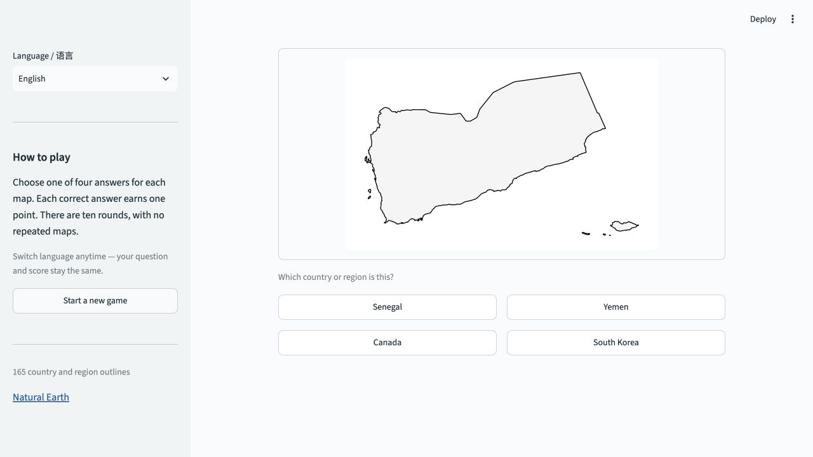

# Map Guesser — Guess the Country

A bilingual geography quiz built with Python and Streamlit. Identify a country or region from its outline, choose one of four answers, and complete a ten-round game.

[中文说明](docs/README.zh-CN.md)



## Features

- 165 country and region outlines from the original project, based on Natural Earth data.
- English by default, with a Chinese language selector. Interface text, answer options, and feedback switch together.
- Missing country-name translations fall back to the available language.
- Ten randomly selected maps per game, with no repeated correct answers and four distinct options per question.
- Immediate answer feedback, progress, scoring, and a fresh-game button.
- Language changes preserve the current question, option order, and score.
- Bundled SVG maps: playing requires no external map API, API key, or GIS installation.

## Run locally

Use Python 3.11 or newer. From the repository root:

```bash
python3 -m venv .venv
source .venv/bin/activate
python -m pip install -r requirements.txt
python -m streamlit run app.py
```

On Windows, activate the environment with `.venv\Scripts\Activate.ps1` in PowerShell. Open the local URL printed by Streamlit, usually `http://localhost:8501`.

## How to play

1. Look at the map outline and choose an answer.
2. Read the feedback, then select **Next question**.
3. After ten rounds, view your score and select **Play again**.

Use **Language / 语言** in the sidebar to switch between English and Chinese at any point. **Start a new game** resets the quiz while keeping your language selection. Scores live in the current Streamlit session and are not stored in a database.

## Project structure

```text
app.py                      Streamlit interface and session integration
mapguesser/
  data.py                   Validated catalog and language fallback
  game.py                   Question generation, scoring, and game state
  i18n.py                   English and Chinese interface strings
data/
  countries.json            Explicit bilingual records with stable IDs
  source/                   Original Natural Earth shapefile and metadata
assets/maps/                165 pre-generated SVG outlines
scripts/build_maps.py       Optional map regeneration tool
tests/                      Game, data, and Streamlit interaction tests
.github/workflows/          Automated formatting, lint, and test checks
```

## Design choices

**Stable IDs, translated labels.** Answers are checked by country ID rather than displayed text. Switching languages changes presentation without changing the question or score. The catalog keeps the Natural Earth `source_name` separately, so expanded English names do not break geometry lookup.

**A small, independent game model.** Question generation and scoring use ordinary Python objects. The interface stores one game per session; the model rejects duplicate submissions and advancing before an answer.

**Generate maps ahead of time.** The application reads bundled SVGs. GeoPandas and Matplotlib are optional tools used to prepare assets, so playing does not require loading or writing a shapefile. Image contents are served without using country names in the image URL.

**Validate data early.** Loading checks IDs, names, map availability, and duplicate display labels. The test suite also parses every bundled SVG and exercises a full ten-round game through Streamlit's AppTest.

## Development

```bash
python -m pip install -r requirements-dev.txt
python -m ruff check .
python -m ruff format --check .
python -m pytest -q
```

GitHub Actions runs these checks on Python 3.11 and 3.13.

### Update names or add a map

Each entry in `data/countries.json` has this form:

```json
{
  "id": "afghanistan",
  "name_en": "Afghanistan",
  "name_zh": "阿富汗",
  "source_name": "Afghanistan"
}
```

IDs use lowercase ASCII letters, numbers, and hyphens. The corresponding asset is `assets/maps/<id>.svg`. Either display-name field may be empty or omitted, but at least one must be available. Keep `source_name` equal to the shapefile's `NAME` value if you plan to regenerate the map.

### Rebuild maps (optional)

```bash
python -m pip install -r requirements-maps.txt
python scripts/build_maps.py
```

This regenerates all assets from the bundled shapefile. To inspect new output before replacing the bundled maps, use `python scripts/build_maps.py --output-dir /path/to/preview-maps`.

## Deploy

The repository is ready for [Streamlit Community Cloud](https://docs.streamlit.io/deploy/streamlit-community-cloud/deploy-your-app). Choose this repository, the branch containing the updated project, `app.py` as the entry point, and Python 3.11 or 3.13. Runtime dependencies are listed in `requirements.txt`; no secrets are needed. This repository does not yet include a hosted demo URL.

## Data and scope

The original 165-entry selection is preserved, including countries and regions; it is not an exhaustive list of sovereign states. English abbreviations are expanded for readability, while original geometry lookup names remain unchanged.

Maps are derived from **Natural Earth 1:10m Admin 0 map units, version 5.1.1**. Original files and accompanying metadata are retained under `data/source/`. Natural Earth map data is in the public domain; see its [terms of use](https://www.naturalearthdata.com/about/terms-of-use/). Made with Natural Earth.
