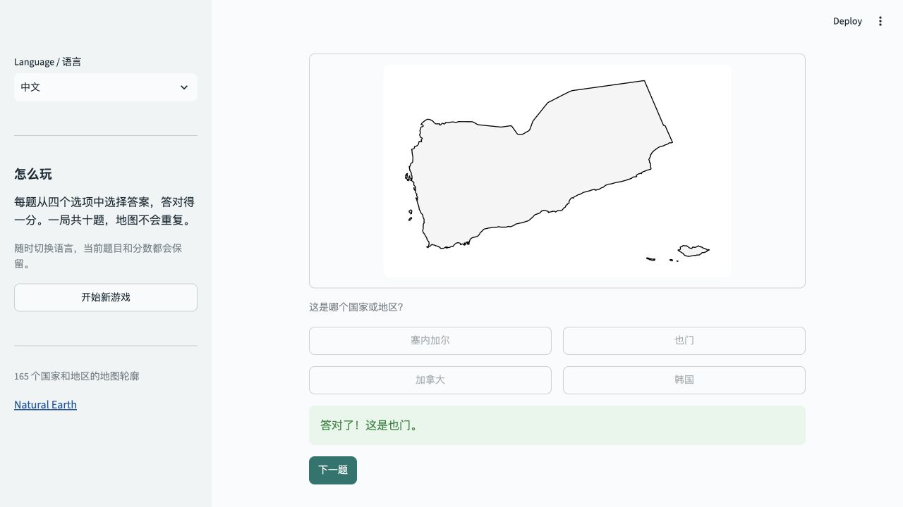

# Map Guesser 地图猜谜

使用 Python 和 Streamlit 开发的双语地理猜谜游戏。观察国家或地区的地图轮廓，从四个选项中选择答案，完成十题挑战。

[English README](../README.md)



## 功能

- 保留原项目的 165 个国家和地区轮廓，地图来自 Natural Earth。
- 默认英文，可在侧栏切换中文；界面、选项、答案反馈会一起切换。
- 某个名称缺少英文时显示中文，缺少中文时显示英文。
- 每局十题，正确答案对应的地图不重复，每题有四个不同选项。
- 切换语言保留当前题目、选项顺序和得分。
- 提供答题反馈、进度、计分、重新开始和再玩一次。
- 使用随项目提供的 SVG 地图，游玩无需地图 API、密钥或 GIS 环境。

## 本地运行

需要 Python 3.11 或更新版本。在项目根目录执行：

```bash
python3 -m venv .venv
source .venv/bin/activate
python -m pip install -r requirements.txt
python -m streamlit run app.py
```

Windows PowerShell 使用 `.venv\Scripts\Activate.ps1` 激活环境。打开启动后显示的本地地址，通常为 `http://localhost:8501`。

## 结构与维护

- `app.py`：界面和 Streamlit 会话。
- `mapguesser/data.py`：题库校验和名称回退。
- `mapguesser/game.py`：出题、计分和游戏状态，不依赖界面框架。
- `mapguesser/i18n.py`：中英文界面文案。
- `data/countries.json`：用明确的记录替代原来的两份逐行对应名单。
- `assets/maps/`：预先生成的地图，文件名使用稳定的 ASCII ID。
- `data/source/`：原始地理数据和说明。
- `tests/`：核心逻辑、数据完整性和实际界面交互测试。

答案按 ID 判断，因此切换语言不会影响计分。每题只接受一次回答，答题后才能进入下一题。分数只保存在当前会话中，不写入数据库。

## 检查与地图更新

```bash
python -m pip install -r requirements-dev.txt
python -m ruff check .
python -m ruff format --check .
python -m pytest -q
```

平时运行游戏只需要 Streamlit。需要重新生成地图时，再安装可选依赖：

```bash
python -m pip install -r requirements-maps.txt
python scripts/build_maps.py
```

名称修改、数据格式和部署步骤见 [英文 README](../README.md)。项目已准备好用于 Streamlit Community Cloud 部署，目前尚未提供线上演示链接。

## 数据来源

使用 Natural Earth 1:10m Admin 0 map units，版本 5.1.1。原始文件及说明保留在 `data/source/`。Natural Earth 地图数据属于公共领域，详见[使用条款](https://www.naturalearthdata.com/about/terms-of-use/)。

题库沿用原项目的 165 项选取，包含国家和地区，并非完整的主权国家列表。英文显示名称补全了部分缩写，地理数据匹配使用的原始名称保持不变。
